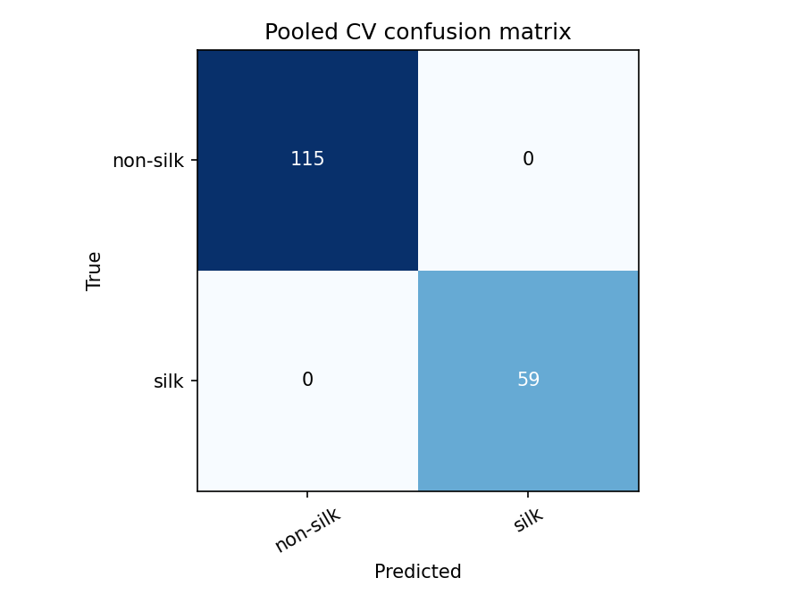
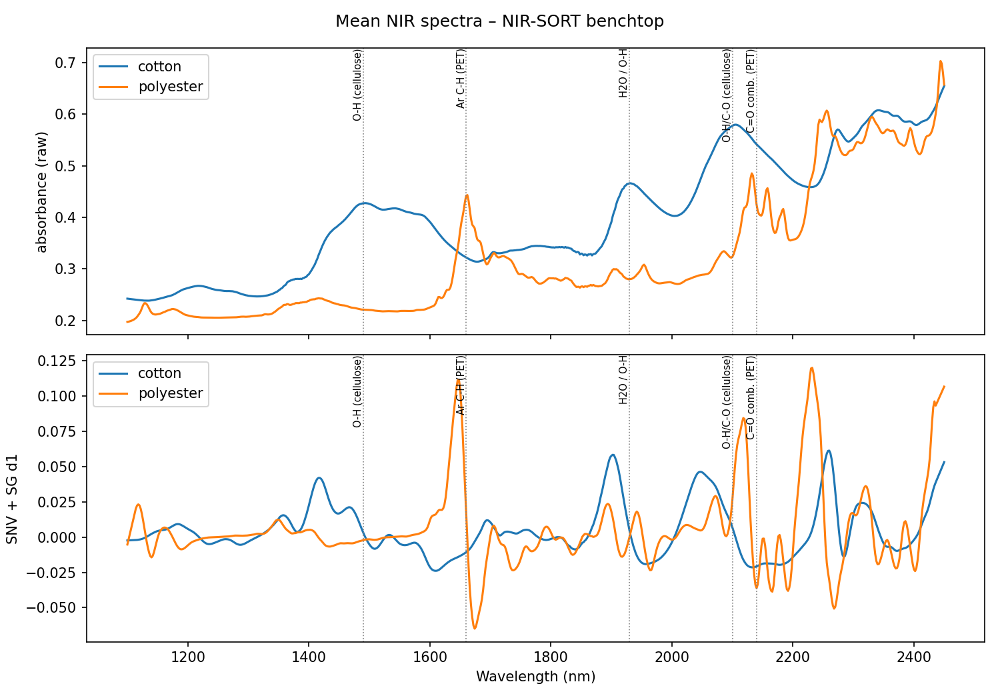
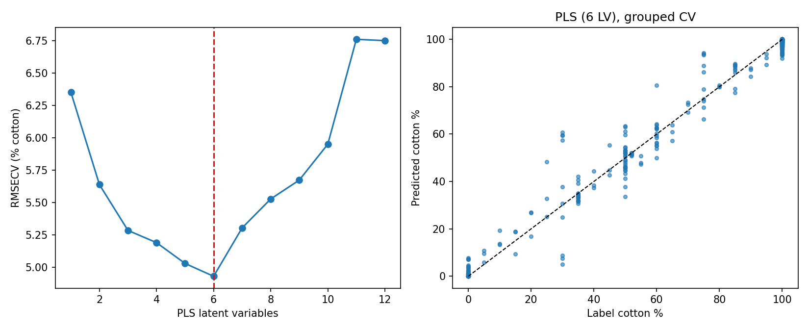
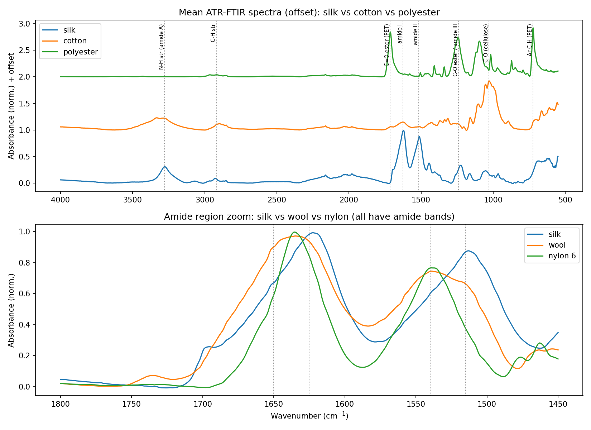
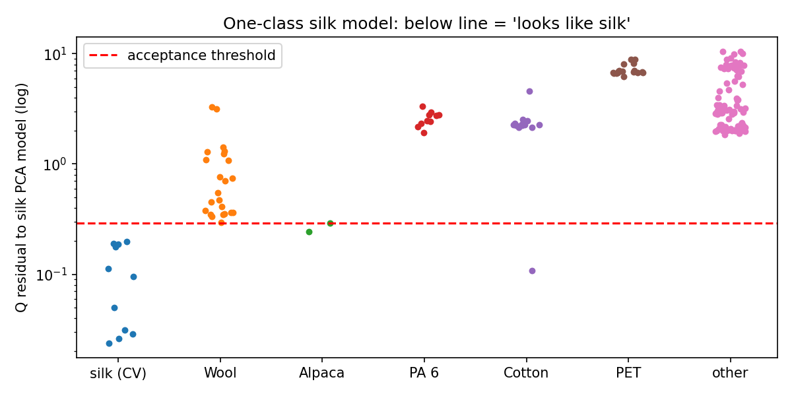

# Low-Cost Identification of Silk, Cotton and Polyester Fabrics

**Image-based and spectroscopic approaches using a phone app and open datasets**

---

## Abstract

Silk is often substituted or mislabelled, and our institute does not have an NIR
spectrometer. This project therefore tests what can be done with **low-cost imaging plus
openly available spectral data** to identify three fibres: **cotton, polyester and
silk**, with the main focus on **silk vs non-silk**. We used four complementary
approaches:

1. **Phone-camera app (our own dataset):** an on-device MobileNetV2 classifier in a
   Flutter app. Test accuracy was **70.4 %** across 3 classes.
2. **Smartphone-microscope images (open Kaggle dataset, 60×):** transfer-learned ResNet18
   for silk vs non-silk and for 3 classes. silk vs non-silk reached **100 %** 5-fold CV accuracy (an upper bound, see §4.2).
3. **NIR spectroscopy (NIST NIR-SORT, open):** pure cotton vs polyester was classified at
   **100 %** across 49 fabrics, and cotton % in blends was predicted with
   **RMSECV ≈ 4.9 %** (R² ≈ 0.98).
4. **ATR-FTIR (King's College London dataset, open):** as a proof of concept, silk vs
   **all 30 other fibre types**, including wool, alpaca and nylon, was correct for
   **136 of 137 samples**. A one-class "silk-only" model rejected 98 % of non-silk spectra.

Spectroscopy separates the fibres by chemistry (amide bands for silk, the ester C=O and
aromatic bands for polyester, cellulose C–O/O–H for cotton). Images capture only surface
appearance, which explains the gap in accuracy between the two families of methods.

---

## 1. Objective

- Identify cotton, polyester and silk fabrics with low-cost, portable methods.
- Focus on **silk vs non-silk**, because silk is the high-value fibre that gets imitated.
- Where no instrument is available to us (NIR), use **open-source datasets** to show
  feasibility.

## 2. Background: why each method can (or cannot) work

| Fibre | Chemistry | NIR markers (nm) | Mid-IR / FTIR markers (cm⁻¹) |
|---|---|---|---|
| Cotton | Cellulose | O–H ~1490, ~1930; O–H/C–O ~2100 | O–H ~3330; C–O ~1030 |
| Polyester (PET) | Aromatic polyester | Aromatic C–H ~1660; C=O combination ~2130–2160 | C=O ester 1715; C–O 1240; aromatic C–H 725 |
| Silk (fibroin) | Protein | N–H ~1510; amide combinations ~2050, ~2180 | N–H ~3280; **amide I ~1620**; **amide II ~1515** |

Silk is the only protein among the three. Its N–H and amide bands are therefore the
chemical "fingerprint" that separates it from cotton and polyester. Wool and nylon also
contain amide groups, which makes them the hardest negatives.

Images (phone or microscope) do not see chemistry. They see weave, lustre, yarn texture
and colour. A satin-weave polyester can look like silk, so lower accuracy is expected
from image methods.

---

## 3. Data and methods

### 3.1 Phone-camera app (own dataset)
- **Data:** Roboflow "Fabric Classification" export (CC BY 4.0). We used 3 of its 7
  classes: train 2,229 images, validation 159, test 159. Images were resized to 224×224,
  and Roboflow augmented the training images 3× (flip, ±10° rotation, ±15 % brightness).
- **Model:** MobileNetV2 (ImageNet weights). It was trained in two stages: first the
  classifier head only, then the top layers were fine-tuned. The model was exported to
  TFLite (8.9 MB) and runs fully on-device in a Flutter app
  (`lib/`, `train_fiber_classifier.py`).

### 3.2 Smartphone-microscope images (open data)
- **Data:** *Microscope images of fabric* (Gupta & Dubey, COMPASS '24; Kaggle, MIT
  licence). Images were taken with an Aopick clip-on microscope on an iPhone at 60×. We
  used the Contrado-Silk (59), Cotton (55) and Polyester (60) folders. For the
  extra-negatives variant we also added nylon, lycra, crepe, jersey and velvet. Satin and
  Cotton-Silk-Blend were excluded on purpose: satin is a weave whose fibre content is not
  stated, and the blend contains silk.
- **Model:** ResNet18 (ImageNet weights), with class-weighted loss and augmentation
  (rotation, flips, crop, mild colour jitter). Evaluation used **5-fold stratified CV**
  scored at the last epoch (no best-epoch selection).
- **Code:** `research/microscope/silk_classifier.py`

### 3.3 NIR spectroscopy (open data)
- **Data:** NIST NIR-SORT v2, benchtop Nicolet iS50 FT-NIR, 833–2500 nm: 718 spectra from
  113 specimens (~7 replicates each). Fibre composition is encoded in each file name.
- **Preprocessing:** wavenumber → nm, 1100–2450 nm on a 2 nm grid, SNV, then a
  Savitzky–Golay 1st derivative (window 15).
- **Models:** PLS-DA (5 latent variables) and RBF-SVM for classification; PLS regression
  for blend %.
- **Validation:** **CV grouped by fabric**, so replicates of the same fabric never appear
  in both train and test.
- **Code:** `research/nir/nir_cotton_polyester.py`

### 3.4 ATR-FTIR (open data, proof of concept)
- **Data:** KCL ATR-FTIR textile fibre dataset (Mendeley, CC BY 4.0). PerkinElmer
  Frontier with diamond ATR, 4000–550 cm⁻¹. 160 spectra from 137 samples covering 31
  fibre subtypes, including **7 silk samples** (Bombyx mori and tussah).
- **Preprocessing:** ALS-baseline-corrected %T → absorbance, using the windows
  3700–2700 and 1800–600 cm⁻¹, then SNV and an SG 1st derivative.
- **Models:** PLS-DA, SVM, and a SIMCA-style one-class PCA model trained on silk only.
- **Validation:** leave-one-**sample**-out.
- **Code:** `research/ftir/ftir_silk.py`

---

## 4. Results

### 4.1 Phone-camera app

| Split | Cotton | Polyester | Silk | Total |
|---|---|---|---|---|
| Test | 60 | 56 | 43 | 159 |

**Test accuracy: 70.4 %** (chance level is 33 %). Validation accuracy levelled off at
about 72 % while training accuracy kept rising, which indicates mild overfitting. Silk had
the fewest images and the most visual overlap with the other two classes.

### 4.2 Smartphone-microscope CNN

| Task | Images | 5-fold CV accuracy |
|---|---|---|
| Silk vs (cotton + polyester) | 174 (59 silk) | **100 % ± 0** (115/115 non-silk, 59/59 silk) |



Perfect separation is an **upper bound**: the silk images likely come from only 1–2 fabrics and images were split randomly, so photos of the same fabric can be in train and test. External testing on new fabrics is needed.

### 4.3 NIR (NIST NIR-SORT)

| Task | Data | Result |
|---|---|---|
| Pure cotton vs polyester | 347 spectra, 40 cotton + 9 PET fabrics | **100 %** (PLS-DA and SVM, both spectrum level and fabric level) |
| Cotton % in cotton/PET blends | 487 spectra, 80 specimens, 0–100 % | **RMSECV 4.93 % cotton, R² 0.983** (PLS, 6 LV) |


*Fig. 1: Mean NIR spectra. PET shows a sharp aromatic C–H peak at ~1660 nm and C=O
combination bands near 2130–2160 nm. Cotton shows broad O–H bands at ~1490 and ~1930 nm
and the cellulose band at ~2100 nm.*


*Fig. 2: Blend regression. Left: RMSECV against the number of PLS latent variables.
Right: predicted vs label cotton %.*

### 4.4 ATR-FTIR (silk proof of concept)

| Task | Result (leave-one-sample-out) |
|---|---|
| A. Silk / cotton / PET (32 samples) | PLS-DA 30/32 samples (spectrum accuracy 92.9 %); SVM 29/32 (90.5 %); silk recall 100 % with PLS-DA |
| B. **Silk vs all 30 other fibre types** (137 samples) | **136/137 samples correct**; silk recall 100 %, precision 91.7 % |
| C. One-class silk model | Silk accepted 11/11; non-silk rejected 146/149 |

The only non-silk sample that task B called silk was an **indigo-dyed denim cotton**
(BIO_COT_041), probably because of dye or sizing residues. In the one-class model, the
two **alpaca** spectra (also a protein fibre) fell on the acceptance boundary.


*Fig. 3: Top: mean ATR-FTIR spectra of silk, cotton and polyester. Bottom: the amide
region. Silk's amide I sits at ~1620 cm⁻¹ (β-sheet fibroin), compared with ~1635 cm⁻¹
for wool and nylon. Silk's amide II sits at ~1512 cm⁻¹, compared with ~1535 cm⁻¹. This
shift is what lets the model separate silk from other amide-containing fibres.*


*Fig. 4: One-class silk model. Spectra below the red line are accepted as silk.*

---

## 5. Comparison

| Method | Cost / portability | Silk vs non-silk | Cotton vs PET | Data used |
|---|---|---|---|---|
| Phone photo + MobileNetV2 | ~₹0, phone only | weak (silk is the most confused class) | moderate | own, 2.5k images |
| Phone + clip-on microscope + ResNet18 | ₹500–3,000 | 100 % CV (upper bound) | not tested | open, 174–480 images |
| NIR (benchtop) | expensive lab instrument; handhelds exist | not tested (no open silk data) | **100 %** | open, 113 specimens |
| ATR-FTIR | lab instrument (common in institutes) | **136/137 samples** | 30/32 samples (3-class) | open, 137 samples |

**Takeaway:** image methods are cheap and portable but limited by appearance.
Spectroscopy identifies the fibre from its chemistry and is far more reliable. For silk
in particular, the amide bands give a direct chemical signature.

## 6. Limitations

- **Silk data is scarce everywhere:** 7 silk samples (FTIR), about 59 microscope images
  (likely from only 1–2 fabrics), and none in the open NIR data. The silk results are
  therefore a proof of concept, not a validated method.
- **No external test** on fabrics we measured ourselves with a spectrometer.
- Random image-level CV in §4.2 may place photos of the same fabric in both training and
  test, which would make the scores optimistic.
- The app has no "none of these" class. Wool, denim and other fabrics are forced into one
  of the three classes.
- NIR blend latent variables and FTIR thresholds were selected using the same CV that is
  reported, which makes those numbers slightly optimistic.

## 7. Future work

1. Measure our own silk, cotton and polyester samples on an IITD ATR-FTIR (or a
   UV-Vis-NIR spectrophotometer with an integrating sphere, which reaches 2500 nm) and use
   them as an external test set.
2. Add a "not cotton/PET/silk" rejection option to the app, for example from the
   one-class idea in §4.4.
3. Collect more silk images (mulberry, tussar, eri, muga) with the clip-on microscope and
   split the data **by fabric**.
4. Use a burn test or 5 % NaOH dissolution as a cheap confirmatory test whenever the image
   model is unsure about silk vs polyester.

## 8. Reproducing

```bash
pip install numpy scipy scikit-learn matplotlib torch torchvision kagglehub
python research/nir/nir_cotton_polyester.py      # downloads ~26 MB from NIST
python research/ftir/ftir_silk.py                # downloads ~25 MB from Mendeley
python research/microscope/silk_classifier.py --no-best-epoch   # Kaggle dataset, 1.3 GB
```

## References and data sources

1. Goodge K.E. et al., *A spectroscopic dataset for known provenance and post-consumer
   textiles* (NIR-SORT), Scientific Data, 2026. Data: https://data.nist.gov/od/id/mds2-3325,
   DOI 10.18126/61v0-rf98.
2. Parkar R. et al., *A dataset of infrared (ATR-FTIR) spectra for textile fibres of
   natural and man-made origin*, Mendeley Data v3, DOI 10.17632/rx3fjgz96x.3 (CC BY 4.0).
3. Gupta D., Dubey A., *Towards Improved Sustainability in the Textile Lifecycle with
   Deep Learning*, COMPASS '24, ACM, DOI 10.1145/3674829.3675077. Data:
   https://www.kaggle.com/datasets/danikagupta/microscope-images-of-fabric (MIT).
4. Roboflow Universe, *Fabric Classification* dataset (CC BY 4.0).
5. Sandler M. et al., MobileNetV2, CVPR 2018. He K. et al., ResNet, CVPR 2016.
